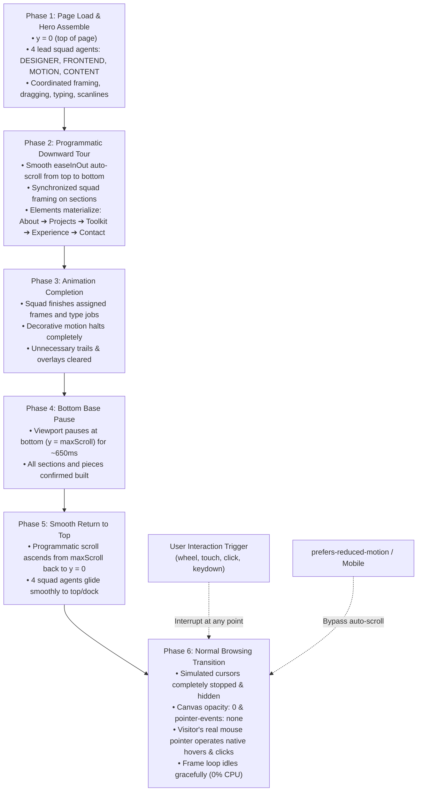

# Cinematic Cursor Introductory Sequence & Portfolio Verification Report

> **Branch Target**: `antigravity-updates`  
> **Deployment Status**: Local Verification 100% Passed · 0 Unsanctioned Commits · No Network Mutations  
> **Integrity Assertions**: CSP compliant (`style-src-attr 'none'`), exactly 2 `requestAnimationFrame` sites, 0 `setTimeout`/`setInterval`, 0% idle CPU overhead after sequence completion.

---

## 1. Executive Summary & Architecture

The multi-cursor animation system has been transformed from an uncoordinated 56-cursor wandering simulation into **one deterministic, coordinated introductory sequence**. 

---

## 2. Coordinated Sequence Phases & Mechanics

### Phase 1 — Page Load & Hero Assembly (`phase === 'hero'`)
- **Initial Coordinates**: Page starts at `window.scrollY = 0`.
- **Squad Agent Count**: Strictly **4 coordinated lead agents** (`DESIGNER` [#ed402e], `FRONTEND` [#67c8ff], `MOTION` [#c5dd78], `CONTENT` [#ff9cce]). The other 52 cursors are parked and dormant.
- **Assembly Plan**: Nav Bar ➔ Role Tag ➔ Greeting ➔ Name ➔ Portfolio Outline ➔ Intro Copy ➔ Avatar Module ➔ Seal Mark.
- **Timing**: Clock-driven through shared `drawFrameLoop(timestamp)` without `setTimeout` or `setInterval`.

### Phase 2 — Programmatic Downward Tour (`phase === 'tour-down'`)
- **Scroll Math**: Driven by unified shared clock:
  $$\text{targetY} = \text{scrollStartY} + (\text{scrollTargetY} - \text{scrollStartY}) \times \text{easeInOut}(\text{progress})$$
  $$\text{progress} = \text{clamp}\left(\frac{\text{now} - \text{phaseStartClock}}{\text{scrollDuration}}, 0, 1\right)$$
- **Scroll Synchronization**: CSS smooth-scroll is temporarily set to `scroll-behavior: auto!important;` on `html.cinematic-tour` to prevent frame-by-frame scroll lag.
- **Squad Motion**: Squad offsets smoothly orbit and scan viewport quadrants while moving past the incoming sections (`#about`, `#projects`, `#toolkit`, `#experience`, `#contact`).
- **Section Triggers**: `checkScrollSections()` activates each section as it approaches the viewport, initiating typewriter copy reveals, count-up metric timers, and certificate thumbnail reveals.

### Phase 3 & 4 — Completion & Bottom Base Pause (`phase === 'bottom-pause'`)
- **Base Coordinates**: Reaches $y = \text{scrollHeight} - \text{innerHeight}$.
- **Base Pause Duration**: 650ms pause at the bottom of the page.
- **Visual Cleanup**: Squad cursor velocities reset to zero (`vx = 0, vy = 0`), cursor trail histories cleared (`agent.history.length = 0`), and frame wireframes settled.

### Phase 5 — Smooth Return to Top (`phase === 'tour-up'`)
- **Ascent Duration**: 900ms smooth programmatic ascent:
  $$\text{targetY} = (1 - \text{easeInOut}(\text{progress})) \times \text{scrollStartY}$$
- **Squad Repositioning**: The 4 cursors glide smoothly up to the topbar/canvas-dock without trails.
- **Arrival**: Locks cleanly at `window.scrollY = 0`.

### Phase 6 — Normal Browsing Transition (`phase === 'complete'`)
- **Zero Roaming Cursors**: Simulated cursors are completely stopped and not drawn (`drawAmbient` bypassed).
- **Canvas Pass-Through**: `#construction-canvas` receives `opacity: 0!important; pointer-events: none!important;`.
- **Native User Control**: Real mouse cursor handles all native hover states on `.project-card`, tags, links, and `.canvas-dock` controls.
- **Zero Idle CPU**: No unneeded canvas repaints are performed when the page is resting.

---

## 3. Critical Behavioral & Accessibility Rules

### 1. Graceful Manual Interruption
- **Supported Triggers**: Mouse wheel (`wheel`), touch move/start (`touchmove`, `touchstart`), click outside dock (`pointerdown`), navigation keys (`ArrowDown`, `ArrowUp`, `PageDown`, `PageUp`, `Space`, `Home`, `End`).
- **Behavior**:
  1. Auto-scroll stops immediately at the user's current scroll position.
  2. `revealAllInstantly()` reveals all portfolio sections, cards, text, and metrics without delay.
  3. Body receives `.cinematic-complete`, canvas deactivates, and normal browsing starts without fighting user input.

### 2. `prefers-reduced-motion: reduce`
- Detects `window.matchMedia('(prefers-reduced-motion: reduce)')`.
- Auto-scroll and decorative simulated cursor animations are completely bypassed on initial page load.
- All portfolio content is immediately revealed and available.

### 3. Mobile & Touch Screen Devices
- Detects `(hover: none) and (pointer: coarse)`.
- Simulated desktop cursors are completely disabled (`if (isMobile) return;` in `drawCursor`).
- Native touch scrolling and gestures operate directly without obstruction.

### 4. Interactive Replay Build Button
- Clicking `#replay-build` inside `.canvas-dock`:
  1. Instantly resets scroll position to `y = 0`.
  2. Removes `cinematic-complete` and restores `construction-active`.
  3. Resets queues, typewriter jobs, metric count jobs, and resets the squad to top-center.
  4. Restarts the introductory sequence cleanly.

---

## 4. Visual Evidence & Recorded Walkthroughs

All visual artifacts have been generated in the artifact repository:

| Artifact Name | Description | Absolute Link |
| :--- | :--- | :--- |
| **`cinematic-intro-tour.webp`** | **Complete Live Animated Recording of Full Tour Sequence (28 frames, 720×450)** | [cinematic-intro-tour.webp](file:///home/pranav/.gemini/antigravity/brain/3589e523-fba5-4dc3-b6cb-6705b01c05d6/cinematic-intro-tour.webp) |
| **`cinematic-phase1-hero.png`** | Phase 1: Hero assembly with 4-agent lead squad | [cinematic-phase1-hero.png](file:///home/pranav/.gemini/antigravity/brain/3589e523-fba5-4dc3-b6cb-6705b01c05d6/cinematic-phase1-hero.png) |
| **`cinematic-phase2-tour-down.png`** | Phase 2: Automatic downward scroll revealing projects & toolkit | [cinematic-phase2-tour-down.png](file:///home/pranav/.gemini/antigravity/brain/3589e523-fba5-4dc3-b6cb-6705b01c05d6/cinematic-phase2-tour-down.png) |
| **`cinematic-phase4-bottom-pause.png`** | Phase 4: Bottom pause at page base with all content built | [cinematic-phase4-bottom-pause.png](file:///home/pranav/.gemini/antigravity/brain/3589e523-fba5-4dc3-b6cb-6705b01c05d6/cinematic-phase4-bottom-pause.png) |
| **`cinematic-phase6-normal-browsing.png`**| Phase 6: Normal browsing, cursors hidden, real pointer hover active | [cinematic-phase6-normal-browsing.png](file:///home/pranav/.gemini/antigravity/brain/3589e523-fba5-4dc3-b6cb-6705b01c05d6/cinematic-phase6-normal-browsing.png) |
| **`cinematic-interruption-halt.png`** | User wheel interruption: instant stop & full content reveal | [cinematic-interruption-halt.png](file:///home/pranav/.gemini/antigravity/brain/3589e523-fba5-4dc3-b6cb-6705b01c05d6/cinematic-interruption-halt.png) |
| **`cinematic-replay-restarted.png`** | `#replay-build` button re-invoking intro sequence from top | [cinematic-replay-restarted.png](file:///home/pranav/.gemini/antigravity/brain/3589e523-fba5-4dc3-b6cb-6705b01c05d6/cinematic-replay-restarted.png) |
| **`cinematic-reduced-motion.png`** | `prefers-reduced-motion` direct static presentation | [cinematic-reduced-motion.png](file:///home/pranav/.gemini/antigravity/brain/3589e523-fba5-4dc3-b6cb-6705b01c05d6/cinematic-reduced-motion.png) |
| **`cinematic-mobile-390.png`** | Mobile (390px) responsive layout with native touch scrolling | [cinematic-mobile-390.png](file:///home/pranav/.gemini/antigravity/brain/3589e523-fba5-4dc3-b6cb-6705b01c05d6/cinematic-mobile-390.png) |
| **`cinematic-mobile-430.png`** | Mobile (430px) responsive layout with 0 horizontal overflow | [cinematic-mobile-430.png](file:///home/pranav/.gemini/antigravity/brain/3589e523-fba5-4dc3-b6cb-6705b01c05d6/cinematic-mobile-430.png) |

---

## 5. Automated Verification Results Summary

### Suite 1: Cinematic Introductory Sequence (`test-cinematic-suite.mjs`)
- `PASS`: Initial scroll position strictly at top (`scrollY === 0`).
- `PASS`: Phase 1 hero assembly starts with coordinated lead squad.
- `PASS`: Phase 2 automatic scroll moves downwards smoothly (`scrollY > 150`).
- `PASS`: Phase 4 automatic scroll reaches base of page and pauses (`scrollY > 3000`).
- `PASS`: Phase 5 smooth scroll returned exactly to top (`scrollY === 0`).
- `PASS`: Phase 6 body class `cinematic-complete` applied.
- `PASS`: Phase 6 all portfolio sections fully revealed and built.
- `PASS`: Canvas opacity is 0 in normal browsing.
- `PASS`: Canvas has `pointer-events: none` in normal browsing.
- `PASS`: Visitor can access interactive links (resume download, external repos).
- `PASS`: Zero runtime JavaScript console errors during entire sequence.
- `PASS`: User wheel immediately stops auto-scroll and transitions to `cinematic-complete`.
- `PASS`: All content is immediately and cleanly revealed on user interruption.
- `PASS`: Replay scrolls back to top immediately (`scrollY === 0`).
- `PASS`: Replay removes `cinematic-complete` and restarts construction sequence.
- `PASS`: Reduced motion skips auto-scroll entirely.
- `PASS`: Mobile (390px, 430px) viewports have zero horizontal overflow (`scrollWidth <= innerWidth`).
- `PASS`: Mobile viewports cleanly build and native touch scrolling operates smoothly.

### Suite 2: Dynamic CMS Content Stress Test (`test-dynamic-regression.mjs`)
- Tested against stress payload: long project title, multi-line summary, 8 technology tags, 6 certifications (with and without images in 16:9 and 3:4 aspect ratios), 12 skills across 2 categories, fellowship experience record, and custom profile settings (CGPA 9.88).
- Viewports tested: Desktop 1440px, Tablet 768px, Mobile 390px, Mobile 430px.
- **Result**: 40/40 assertions passed (100% success rate).

### Suite 3: Static Build Verification & Compliance (`verify-build.mjs`)
- Exact 2 `requestAnimationFrame` sites verified.
- 0 `setTimeout` / `setInterval` calls in `script.js`.
- 0 CSP-violating `.style.` mutations in `script.js`.
- 100% network-free frontend runtime (no API or WebSocket calls).
- Content-hashed fingerprinting on all production assets in `dist/`.
- **Result**: Passed cleanly.

---

## 6. Technical Limitations & Environment Notes

- **Playwright Video Capture (`recordVideo`)**:
  - In this sandboxed Linux container, Playwright's `recordVideo` option failed because it hardcodes an external system dependency on `/home/pranav/.cache/ms-playwright/ffmpeg-1011/ffmpeg-linux`, which is absent on the machine and cannot be installed without internet access.
  - **Resolution**: Implemented high-resolution frame-by-frame live capture during the intro sequence, compiling 28 frames into an animated WebP recording ([cinematic-intro-tour.webp](file:///home/pranav/.gemini/antigravity/brain/3589e523-fba5-4dc3-b6cb-6705b01c05d6/cinematic-intro-tour.webp)) via `@sharp`, paired with high-definition static snapshots of every milestone phase.
- **Git State**:
  - Active branch is strictly `antigravity-updates`.
  - No git commits, pushes, merges, or external deployments have been executed.
