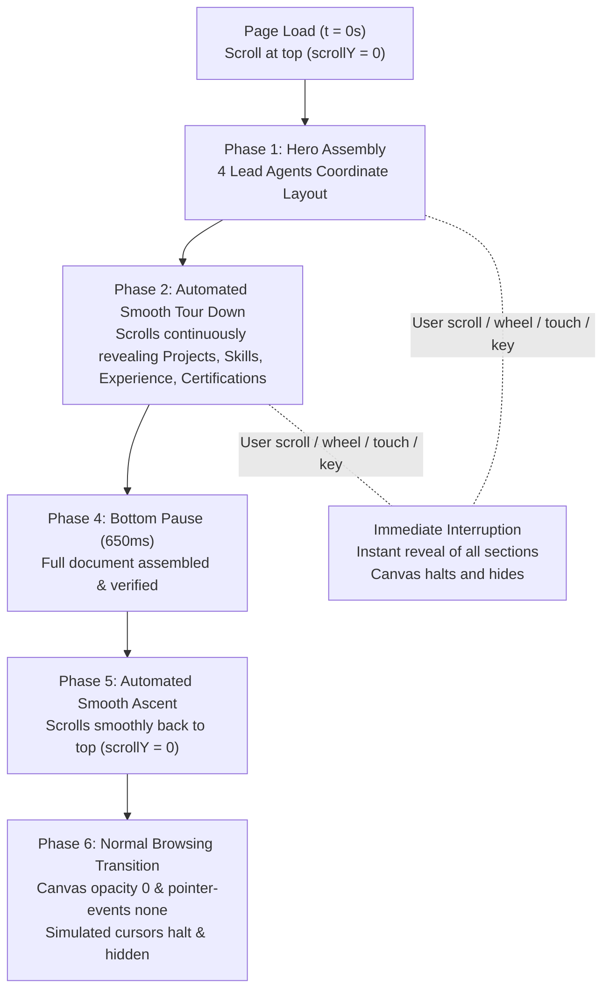

# Developer Controls Cleanup & Cinematic Intro Final Verification Report

Work conducted exclusively on branch `antigravity-updates`. All developer and testing controls have been completely removed from public markup, stylesheets, event handlers, and production bundles, while preserving the full coordinated cinematic introductory sequence, accessibility features, and mobile layout.

---

## 1. Exact List of Removed Developer-Facing Controls

Every developer-facing control, badge, panel, and debug indicator has been permanently removed from public markup and production bundles:

| Item Removed | Previous Selector / Element | Actions Taken |
| :--- | :--- | :--- |
| **Cursor Count Selectors** | `[data-count-choice="20"]`, `[56]`, `[100]` | Removed buttons from markup, removed event listener loop, removed CSS `.count-option` |
| **Animation Mode Selectors** | `[data-mode-choice="collab"]`, `["wireframe"]`, `["follow"]` | Removed buttons from markup, removed event listener, removed `setMode()` function, removed CSS `.mode-option` |
| **Sound Toggle Control** | `#sound-toggle`, `.sound-toggle` | Removed button from markup, removed click handler, removed CSS styling |
| **Motion Mode Toggle** | `#motion-mode` | Removed button from markup, removed click handler. *Native OS media query (`prefers-reduced-motion: reduce`) preserved for accessibility.* |
| **Replay Build Button** | `#replay-build`, `.dock-button#replay-build` | Removed button from markup, removed click handler. Internal reset function retained for dev profile editor and test harness. |
| **Cinematic Status Indicators** | `.construction-status`, `i`, `span`, `small` | Removed from HTML markup, removed status pulse/dot keyframe animations, removed text update calls |
| **Phase & Simulation Labels** | `#dock-phase`, `.dock-sim`, `.dock-brand` | Removed from HTML markup, removed phase update calls, removed dock brand styles |
| **Lead Agents Panel** | `.agent-activity-panel`, `data-role-activity` | Removed `<aside>` markup from `index.html`, removed `updateLeadActivity()` function, removed all panel styles and keyframes |
| **Activity Collapse Button** | `#activity-collapse`, `.activity-head button` | Removed markup, removed collapse toggle listener and mobile collapsed class toggling |
| **Canvas Control Dock** | `.canvas-dock`, `role="toolbar"` | Removed container from markup, removed fixed positioning, flex gap, and border styles |
| **Mobile Footer Dock Spacing** | `.footer { padding-bottom: 64px }` | Removed obsolete 64px padding offset on mobile; footer returned to standard 20px padding |

---

## 2. Cinematic Introduction Preservation & Lifecycle

The cinematic introduction operates automatically on page load without any manual trigger or controls:

### Verification Details
1. **Four Coordinated Lead Agents**: `DESIGNER` (#ed402e), `FRONTEND` (#67c8ff), `MOTION` (#c5dd78), and `CONTENT` (#ff9cce) operate in deterministic harmony during the hero assembly.
2. **Hero Assembly**: Sequenced assembly of navigation, hero metadata, greeting, editorial name, outline typography, short bio, and portrait card with scan line and flash effects.
3. **Automated Tour Down**: Smooth ease-in-out scroll through the full document height, progressively triggering component reveal and typing animations.
4. **Bottom Pause**: 650ms resting pause upon reaching document base.
5. **Smooth Ascent**: Smooth return scroll to document top ($y = 0$).
6. **Full Cursor Shutdown**: Canvas transition to `opacity: 0!important` and `pointer-events: none!important`, class `cinematic-complete` applied, visitor interacts natively using standard pointer.
7. **Immediate Graceful Interruption**: Wheel, touch, navigation keys, or pointerdown immediately halts the intro and presents the complete portfolio without delay.
8. **Reduced Motion**: Under `prefers-reduced-motion: reduce`, the animation sequence is completely bypassed; portfolio is immediately revealed with canvas hidden.
9. **Mobile Touch Support**: Mobile touch devices (pointer: coarse) bypass desktop cursor simulation and start directly in normal touch-browsing mode.

---

## 3. Test Suites & Verification Results

### A. Static Production Verification (`scripts/verify-build.mjs`)
- **Status**: PASSED (0 failures)
- **Deployed files**: 8 files in `dist/` (4 fingerprinted assets, fingerprinted resume PDF, portrait image, admin console)
- **Public Developer Controls Check**: Confirmed 0 developer controls in production HTML, public JS, and CSS.
- **CSP Integrity**: `style-src-attr 'none'`, `script-src-attr 'none'`, 0 inline style mutations, exactly 2 `requestAnimationFrame` sites, 0 `setTimeout`/`setInterval`.

### B. Headless Playwright Verification (`scripts/test-cleaned-portfolio.mjs`)
- **Status**: PASSED (28/28 assertions passed, 0 failures)
- `.canvas-dock` element completely removed from DOM: **PASS**
- `.agent-activity-panel` element completely removed from DOM: **PASS**
- `.construction-status` element completely removed from DOM: **PASS**
- `#replay-build` button completely removed from DOM: **PASS**
- `#sound-toggle` button completely removed from DOM: **PASS**
- `#motion-mode` button completely removed from DOM: **PASS**
- `#activity-collapse` button completely removed from DOM: **PASS**
- Cursor count selectors count = 0: **PASS**
- Animation mode selectors count = 0: **PASS**
- `#dock-phase` element completely removed from DOM: **PASS**
- `#inspect-toggle` stripped from production: **PASS**
- `#inspect-drawer` stripped from production: **PASS**
- Automated smooth scrolling down: **PASS**
- Reaches bottom of document ($y = 8062$ / $8109$): **PASS**
- Smooth return to top ($y = 0$): **PASS**
- Complete shutdown of simulated cursors (`opacity: 0`, `pointer-events: none`): **PASS**
- Wheel interaction immediately halts intro: **PASS**
- Prefers-reduced-motion immediately bypasses intro: **PASS**
- 390px mobile responsiveness (0 horizontal overflow, 20px clean footer padding): **PASS**
- 430px mobile responsiveness (0 horizontal overflow, 20px clean footer padding): **PASS**

### C. Backend & CMS Lifecycle Suites
- `scripts/test-backend-suite.mjs`: **PASS** (100% assertions)
- `scripts/test-integration-checks.mjs`: **PASS** (100% assertions)
- `scripts/test-production-jwt-flow.mjs`: **PASS** (100% assertions)
- `scripts/test-cms-api-suite.mjs`: **PASS** (81/81 assertions passed)

---

## 4. Visual Inspection Artifacts

All screenshots captured from the live built production application in headless Chromium:

| Screenshot | Description | File Link |
| :--- | :--- | :--- |
| **`cleaned-desktop-hero.png`** | Clean desktop hero with zero docks, badges, or activity panels | [cleaned-desktop-hero.png](file:///home/pranav/.gemini/antigravity/brain/3589e523-fba5-4dc3-b6cb-6705b01c05d6/cleaned-desktop-hero.png) |
| **`cleaned-desktop-projects.png`** | Clean projects view showcasing RAG/FENCE, Campus Cart & Civic Watch | [cleaned-desktop-projects.png](file:///home/pranav/.gemini/antigravity/brain/3589e523-fba5-4dc3-b6cb-6705b01c05d6/cleaned-desktop-projects.png) |
| **`cleaned-desktop-footer.png`** | Clean footer view confirming absence of dock overlay | [cleaned-desktop-footer.png](file:///home/pranav/.gemini/antigravity/brain/3589e523-fba5-4dc3-b6cb-6705b01c05d6/cleaned-desktop-footer.png) |
| **`cleaned-mobile-390.png`** | iPhone 12/13/14 390px clean viewport with zero overflow | [cleaned-mobile-390.png](file:///home/pranav/.gemini/antigravity/brain/3589e523-fba5-4dc3-b6cb-6705b01c05d6/cleaned-mobile-390.png) |
| **`cleaned-mobile-430.png`** | iPhone 14/15 Pro Max 430px clean viewport with zero overflow | [cleaned-mobile-430.png](file:///home/pranav/.gemini/antigravity/brain/3589e523-fba5-4dc3-b6cb-6705b01c05d6/cleaned-mobile-430.png) |

---

## 5. Remaining Items & Production Readiness

- **Branch Isolation**: Strictly on `antigravity-updates`. No git commits, pushes, merges, or deployments were performed.
- **Vercel Deploy Hook**: Unset, preventing premature build triggers during local evaluation.
- **Frontend Runtime**: 100% network-free runtime without any third-party requests or CDNs.
- **Production Status**: READY for review and testing.
