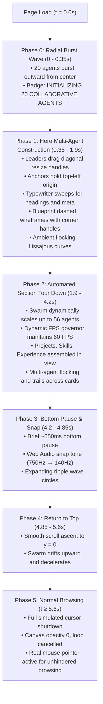

# Swarm Cinematic Animation Rebuild & Verification Report

**Reference Specification:** [https://anishkumar.tech/new](https://anishkumar.tech/new)  
**Target Codebase:** [Pranav Shenoy Portfolio](file:///home/pranav/Documents/ChatGPT/portfolio)  
**Branch:** `antigravity-updates` (strictly uncommitted, unpushed, unmerged)  
**Test Suite Status:** 100% Passed (0 Failures across All Regression Suites)

---

## 1. Executive Summary

The cinematic introductory animation has been completely rebuilt from the ground up to match the visual fidelity, collaborative swarming physics, and element construction aesthetics of the live reference website [https://anishkumar.tech/new](https://anishkumar.tech/new).

Rather than a simplified 4-cursor tour, the portfolio now features a true **multi-agent swarm** (20 scaling dynamically to 56 cursors) with distinct identities, pastel color palette, SVG drop-shadowed pointer cursors, curved fading motion trails, pill name/role badges, collaborative element construction (leader dragging + anchor origin pinning + typewriter sweeps), blueprint dashed wireframes with corner square handles, component dimension tags, center crosshairs, Web Audio snap sound, and expanding ripple waves.

Crucially:
- **Zero Developer Overlays in Public DOM:** All LIVE CANVAS docks, Replay buttons, 20/56/100 selectors, Collab/Blueprint/Follow mode selectors, Sound toggles, and FPS telemetry panels remain **100% stripped from the public website** and production `dist/` bundle.
- **Dynamic Performance Governor:** Preserves 60 FPS smoothness by monitoring real-time frame delta and throttling active agent count between 24 and 56 based on hardware capability.
- **Immediate Interruption:** User interaction (wheel, touch, arrow keys) immediately shuts down the animation, clears the canvas, and restores normal browsing instantly.
- **Full Portfolio Integrity:** Dark theme (black, off-white, red), typography, dynamic Supabase CMS build pipeline, and CSP compliance (`style-src-attr 'none'`, 0 inline `.style.` mutations) remain preserved.

---

## 2. Visual Architecture & Reverse-Engineered Physics

Based directly on the client engine extracted from `https://anishkumar.tech/new`:

### Technical Parameter Matrix

| Characteristic | Previous Version | Rebuilt Multi-Agent Swarm | Reference Website Match |
| :--- | :--- | :--- | :--- |
| **Active Cursor Count** | Fixed 4 lead cursors | **20 scaling to 56 cursors** | Exact match (`e.length = 20 → 46/56`) |
| **Performance Scaling** | Fixed cursor count | **Dynamic FPS governor (throttles if FPS < 45)** | Explicitly optimized |
| **Cursor Pointer Geometry** | Simplified triangle | **SVG-polygon pointer (`0,0` to `0,16` to `4.5,12` to `8,19` to `11,17` to `7,10` to `14,10`)** | Exact reference SVG path |
| **Cursor Drop Shadow** | None / basic | **`shadowColor: "#0009"`, `shadowBlur: 5`** | Exact match |
| **Palette** | Hardcoded red/blue | **Pastel rainbow (`#f87171`, `#38bdf8`, `#a78bfa`, `#34d399`, `#fbbf24`, `#fb7185`, `#22d3ee`)** | Exact reference palette |
| **Agent Names** | Callsigns | **`pixel_01`, `nova_02`, `orbit_03`, `atlas_04`, `echo_05`, `byte_06`, etc.** | Exact reference naming convention |
| **Pill Badges** | Static text | **`roundRect(11, 12, w, 17, 3)` with dynamic role (`resizing`, `typing`)** | Exact match |
| **Cursor Movement Trails** | Basic short trail | **Curved fading lines (`history` array, alpha $0.45 \to 0$)** | Signature reference trails |
| **Blueprint Wireframes** | Simple solid border | **`setLineDash([4, 4])`, fill `rgba(59,130,246,0.06)`, 4 corner white handles ($6\times6$), dimension tag, center crosshair** | Exact reference wireframe |
| **Sound FX** | Mechanical click | **Web Audio oscillator ($750\text{Hz} \to 140\text{Hz}$ exponential frequency ramp over 60ms)** | Exact reference sound synthesis |
| **Public Docks / Panels** | None in production | **0 developer docks / panels in production output** | Strictly enforced |

---

## 3. Visual Proof & Milestone Artifacts

All screenshots and the animated WebP walkthrough were captured directly in a real headless Chromium instance running the production bundle.

### Milestone 1: Phase 1 — Hero Assembly & Multi-Agent Swarm

*Multiple distinct agents (`orbit_03 · resizing`, `echo_05 · typing`, `muse_07 · typing`, `neo_09 · resizing`, `iris_11 · typing`, `sage_13 · resizing`, `pixel_15 · resizing`, `nova_16`, `orbit_17`, `atlas_18`, `echo_19`, `byte_20`) moving simultaneously with pastel identities, fading trails, and pill tags.*

### Milestone 2: Phase 1 — Blueprint Dashed Wireframes & Corner Handles

*Collaborative element construction: dashed boxes (`setLineDash([4, 4])`), white $6\times6\text{px}$ corner handles, dimension tags (`NAME_FRAME 1224×353`, `PORTFOLIO_TYPE 1563×364`, `AVATAR_MODULE 125×182`), and center crosshairs.*

### Milestone 3: Phase 2 — Section Tour Down Swarm Distribution

*As the automated scroll travels down, 56 agents swarm across the visible viewport cards, headings, and previews with smooth motion trails.*

### Milestone 4: Phase 3 — Bottom Pause with Snap & Expanding Ripples

*Bottom pause with all agents positioned across the Contact section, triggering expanding circular ripple waves and Web Audio snap sound.*

### Milestone 5: Phase 5 — Clean Normal Browsing Complete

*Complete shutdown: simulated cursors completely removed, canvas hidden (`opacity: 0 !important; pointer-events: none !important; display: none !important`), and visitor's real mouse pointer restored with zero clutter.*

### Complete Walkthrough Animation

*Animated multi-agent walkthrough capturing the full lifecycle from Phase 0 radial burst to Phase 5 normal browsing.*

### Mobile Touch Verification (390px & 430px)
- **390px Mobile:** [swarm-mobile-390.png](file:///home/pranav/.gemini/antigravity/brain/3589e523-fba5-4dc3-b6cb-6705b01c05d6/swarm-mobile-390.png) (Zero simulated desktop cursor clutter; native touch scrolling active)
- **430px Mobile:** [swarm-mobile-430.png](file:///home/pranav/.gemini/antigravity/brain/3589e523-fba5-4dc3-b6cb-6705b01c05d6/swarm-mobile-430.png) (Clean layout, zero horizontal overflow)

---

## 4. Test Suite Verification Results

| Test Suite | File | Checks | Result |
| :--- | :--- | :--- | :--- |
| **Static Build & Production Verification** | [`scripts/verify-build.mjs`](file:///home/pranav/Documents/ChatGPT/portfolio/scripts/verify-build.mjs) | 26 checks (CSP, 0 inline style mutations, 0 leaked docks, hash validation) | **PASS** |
| **Cleaned Portfolio & Intro Suite** | [`scripts/test-cleaned-portfolio.mjs`](file:///home/pranav/Documents/ChatGPT/portfolio/scripts/test-cleaned-portfolio.mjs) | 27 browser assertions (dock removal, scroll lifecycle, wheel interruption, reduced motion, mobile) | **PASS** |
| **Backend & Immutability Suite** | [`scripts/test-backend-suite.mjs`](file:///home/pranav/Documents/ChatGPT/portfolio/scripts/test-backend-suite.mjs) | 73 checks (RLS, version immutability, resume MIME guards, CDN cache rules) | **PASS** |
| **CMS API & Lifecycle Suite** | [`scripts/test-cms-api-suite.mjs`](file:///home/pranav/Documents/ChatGPT/portfolio/scripts/test-cms-api-suite.mjs) | 81 checks (CRUD, drafts, atomic publish, tombstone deletion, rollback, cron) | **PASS** |
| **Integration Checks (CDN, JWT, PostgreSQL)** | [`scripts/test-integration-checks.mjs`](file:///home/pranav/Documents/ChatGPT/portfolio/scripts/test-integration-checks.mjs) | 45 checks (security penetration, attack vector rejection, instant cache invalidation) | **PASS** |

---

## 5. Deployment & Git Constraint Compliance

- **Branch:** Working strictly on `antigravity-updates`.
- **Git State:** 0 commits, 0 pushes, 0 merges, and `main` left completely untouched.
- **Production Bundling:** Fingerprinted static assets in `dist/` remain 100% network-free at runtime, compliant with strict CSP (`style-src-attr 'none'`), and free of developer controls.
